<picture><source media="(prefers-color-scheme: dark)" srcset="assets/hero-dark.svg"></picture>

<picture><source media="(prefers-color-scheme: dark)" srcset="assets/social-l-dark.svg"></picture><a href="https://t.me/vzval"><picture><source media="(prefers-color-scheme: dark)" srcset="assets/social-1-dark.svg"></picture></a><picture><source media="(prefers-color-scheme: dark)" srcset="assets/social-r-dark.svg"></picture>

<picture><source media="(prefers-color-scheme: dark)" srcset="assets/stats-dark.svg"></picture>

<a href="https://github.com/therample/Shodaner"><picture><source media="(prefers-color-scheme: dark)" srcset="assets/project-shodaner-dark.svg"></picture></a>&nbsp;<a href="https://github.com/therample/GG-Assistant"><picture><source media="(prefers-color-scheme: dark)" srcset="assets/project-gg-assistant-dark.svg"></picture></a>

<a href="https://github.com/therample/dota2-chameleon"><picture><source media="(prefers-color-scheme: dark)" srcset="assets/project-dota2-chameleon-dark.svg"></picture></a>&nbsp;<a href="https://github.com/therample/fuzzy-couscous"><picture><source media="(prefers-color-scheme: dark)" srcset="assets/project-fuzzy-couscous-dark.svg"></picture></a>

<picture><source media="(prefers-color-scheme: dark)" srcset="assets/wave-dark.svg"></picture>

<a href="https://metawka.github.io/expressive-profile/?from=therample"><picture><source media="(prefers-color-scheme: dark)" srcset="assets/credit-dark.svg"></picture></a>

